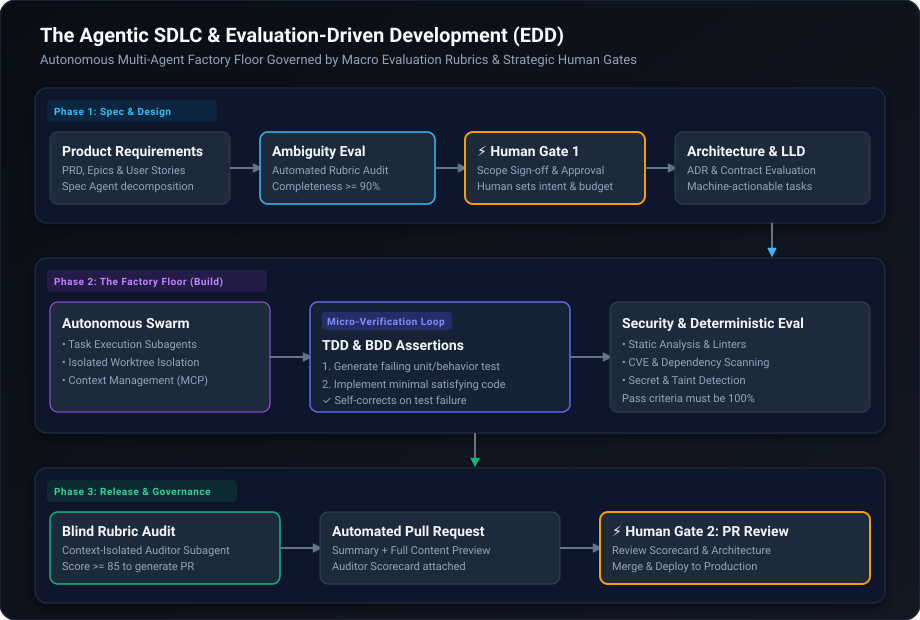

For decades, software development has been framed around a central activity: human engineers sitting in front of code editors, crafting syntax line by line. Even the first wave of generative AI—GitHub Copilot, cursor autocompletes, and inline chat sidebars—retained this exact mental model. The AI acted as a slightly smarter autocomplete, but the human remained the primary typist and runner of every micro-command.

However, writing syntax represents at most **20% of the software engineering lifecycle**. The remaining 80% is the hard part: clarifying ambiguous requirements, modeling architectural trade-offs, writing regression suites, conducting code reviews, managing CI/CD pipelines, enforcing security compliance, and triaging production incidents.

As explored in Port's breakdown of the **Agentic SDLC** (*"Agentic SDLC Explained for Developers!"*), software engineering is undergoing an irreversible shift. Instead of treating AI as an interactive text editor plugin, modern engineering teams are structuring delivery around autonomous, multi-agent software pipelines. 

Yet as autonomous agents begin generating code across whole repositories, a critical architectural question emerges: **Where do Test-Driven Development (TDD) and Behavior-Driven Development (BDD) fit—and why are they no longer sufficient to govern this new reality?**

---

### The Macro Pipeline: From PRD to Production

In real-world software delivery, code does not materialize out of thin air. It traverses a structured, multi-stage funnel:

> **PRD** &rarr; **System Design** &rarr; **Architecture** &rarr; **Low-Level Design (LLD)** &rarr; **Implementation** &rarr; **Tests** &rarr; **Security** &rarr; **Release**

In an **Agentic SDLC**, the handoffs between these phases are executed by autonomous, specialized agents and guarded by deterministic evaluation checkpoints:

#### 1. Specification & Design Gate
* **Input Artifact:** Product Requirements Document (PRD) or User Stories.
* **Autonomous Agent Action:** Spec agents analyze user requirements, detect ambiguities, decompose epics into modular tasks, and flag edge cases.
* **Evaluation Gate:** Automated requirements completeness rubric (scoring clarity, testability, and scope).
* **Human Checkpoint:** Scope sign-off and architectural intent alignment.

#### 2. Architecture & Contract Gate
* **Input Artifact:** Approved PRD.
* **Autonomous Agent Action:** Architecture agents evaluate existing service boundaries, database schemas, and architectural decision records (ADRs) to draft interface contracts.
* **Evaluation Gate:** ADR conformance rubric and interface contract linters.

#### 3. Build & Micro-Verification (The Factory Floor)
* **Input Artifact:** Low-Level Design (LLD) and task breakdown.
* **Autonomous Agent Action:** Subagent swarm implements code within isolated worktrees.
* **Micro-Verification Loop (Where TDD/BDD Lives):** Inner red-green-refactor loop generating unit tests and confirming execution evidence before committing.

#### 4. Security & Compliance Gate
* **Input Artifact:** Implemented code and passing test suites.
* **Autonomous Agent Action:** Security agents execute static analysis, dependency vulnerability scans (CVEs), and secret leak detection.
* **Evaluation Gate:** Deterministic security pass/fail gates and automated linting.

#### 5. Release & Governance Gate
* **Input Artifact:** Verified codebase and test evidence.
* **Autonomous Agent Action:** Pre-release packaging and automated Pull Request generation.
* **Evaluation Gate:** Blind editorial rubric audit (scoring overall technical rigor and documentation).
* **Human Checkpoint:** Strategic Pull Request review, architectural validation, and production merge.

---

### Why TDD and BDD Alone Don't Fit the Macro Lifecycle

When engineers first transition to AI coding agents, their instinctive reaction is to double down on **Test-Driven Development (TDD)** or **Behavior-Driven Development (BDD)**. After all, if an agent writes tests first, shouldn't that guarantee correctness?

TDD and BDD remain vital, but they are **micro-loop mechanisms**, not macro lifecycle governance frameworks:

* **TDD/BDD Assumes Deterministic Code Written by Humans:** TDD was designed for deterministic systems where a human reasons about an edge case, writes a failing assertion (`assert add(2, 2) == 4`), and writes the minimal code to satisfy it. 
* **The "Passing Test" Hallucination:** In an agentic environment, an agent can effortlessly satisfy a local unit test while introducing catastrophic macro regressions. It might hardcode edge cases, violate global interface contracts, use deprecated APIs, or introduce quadratic performance loops that a unit test never catches.
* **Micro vs. Macro Scope:** BDD verifies whether a specific feature satisfies a given behavioral scenario (*"Given a user is logged in, when they click..."*). But BDD cannot answer: *Is this PRD aligned with our platform architecture? Does this Low-Level Design introduce state fragmentation? Is this PR architecturally sound?*

In short: **TDD and BDD prevent syntax bugs at the micro level, but they cannot prevent architectural drift across the macro pipeline.**

---

### The Paradigm Shift: Evaluation-Driven Development (EDD)

To govern autonomous agents navigating the entire path from PRD to Release, the industry is adopting **Evaluation-Driven Development (EDD)**.

While TDD focuses on binary unit assertions (`pass` or `fail`), **EDD treats evaluation, rubric measurement, and golden benchmarks as the primary steering system** across every phase of the development lifecycle:

* **Operating Level:**
  * **TDD:** Micro-level focus (individual functions, classes, and isolated modules).
  * **EDD:** Macro-level governance (PRD clarity, architectural boundaries, LLD state management, and full-system release gates).

* **Verification Logic:**
  * **TDD:** Binary assertions (`assert x == y`).
  * **EDD:** Multi-tiered evaluation combining deterministic assertions, static analysis, LLM judges, and objective rubric scoring.

* **Execution Timing:**
  * **TDD:** Executed locally right before writing implementation code.
  * **EDD:** Codified upfront as acceptance rubrics before every phase transition (from spec to release).

* **Handling of Drift:**
  * **TDD:** Catches syntax regressions and broken logic in existing code.
  * **EDD:** Catches behavioral drift, cognitive degradation, and architectural entropy across the multi-agent pipeline.

#### How EDD Operates Across the Pipeline

1. **PRD Evaluation Gate:** Before architecture work begins, an evaluator agent scores the PRD against a requirements rubric (measuring ambiguity, completeness, and non-functional requirements). A human signs off on the evaluated scope.
2. **Architecture & LLD Evaluation Gate:** Contract linters and ADR evaluators verify that proposed designs conform to system boundaries and security standards.
3. **Implementation & Test Gate (Where TDD Lives):** During implementation, the agent runs localized TDD loops inside isolated worktrees, generating unit tests and confirming execution evidence before claiming completion.
4. **Pre-Release Blind Rubric Audit:** Before a Pull Request is opened, an independent, context-isolated auditor agent evaluates the entire changeset against an objective quality rubric (scoring technical rigor, security posture, documentation clarity, and test coverage).
5. **Human PR Gate:** The Pull Request becomes the ultimate strategic human checkpoint. Instead of reading thousands of lines of raw diffs, human reviewers review the **Evaluation Scorecard**, the automated test proofs, and the architectural delta.

---

### Human-in-the-Loop vs. Human-on-the-Loop

The Agentic SDLC does not eliminate developers; it reclaims their cognitive bandwidth. 

When humans try to micromanage agents line-by-line in a chat window, they suffer severe fatigue and fall into "vibes-based" approvals—skimming code and clicking approve. 

By replacing constant interruptions with **strategic human gates powered by rubric evaluations**, engineers transition from code typists to **system architects**:
- **Humans Set Intent & Constraints:** Framing the problem in the PRD and approving high-level architecture.
- **Agents Execute the Factory Floor:** Decomposing tasks, running TDD cycles, running static analysis, and updating documentation.
- **Evals Filter the Noise:** Automated rubrics ensure that work reaching human review has already passed rigorous multi-point verification.
- **Humans Gate the Release:** Giving final architectural sign-off on the Pull Request.

---

### The New Engineering Reality

1. **TDD is a Subsystem, Not the Strategy:** Use TDD as an inner execution loop for agents writing code, but rely on EDD to govern the macro journey from PRD to production.
2. **Codify Success Criteria Upfront:** If an agent cannot measure what "good" looks like through an objective rubric, it will drift into generic or brittle implementations.
3. **Isolate Reviewers to Avoid Context Pollution:** Automated review and rubric scoring must run in clean, unpolluted contexts to prevent confirmation bias.
4. **Make Pull Requests the True Governance Checkpoint:** Build pipelines where PRs arrive with complete evaluation audit trails, leaving humans free to focus on architecture, business value, and safety.

---

### References & Sources

- **Port's Video Breakdown:** [Agentic SDLC Explained for Developers! (YouTube 21tuT-e4NVo)](https://www.youtube.com/watch?v=21tuT-e4NVo)
- **Port Engineering:** [The Agentic Software Development Lifecycle](https://www.port.io/blog/agentic-sdlc)
- **CodeRabbit:** [Agentic SDLC Framework & Verification](https://www.coderabbit.ai/blog/agentic-sdlc-framework)
- **Arize AI:** [Evaluation-Driven Development (EDD) for AI Agents](https://arize.com/blog-course/eval-driven-development/)
- **Antigravity Customization Documentation:** [Google Antigravity SDK & Skill System](https://antigravity.google/docs)
