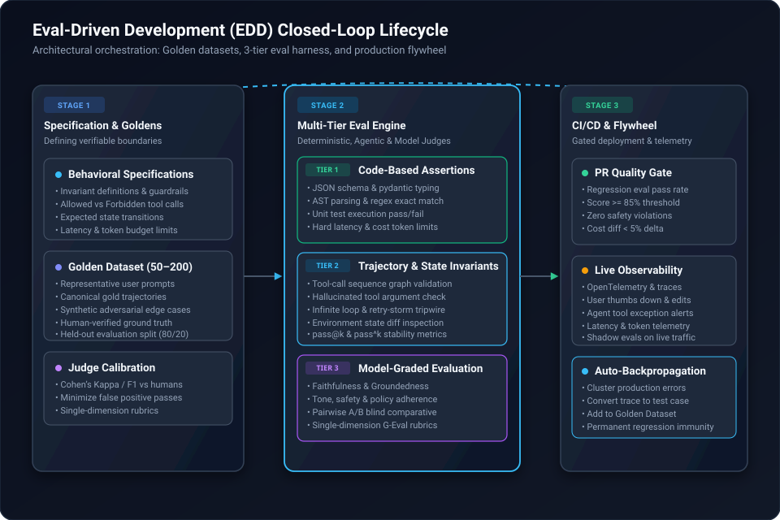

Every engineering team building with Large Language Models (LLMs) and autonomous agents encounters the same sobering inflection point. 

In the prototype phase, everything feels magical. You write a system prompt, paste three sample inputs into an interactive playground, tweak a few instructions, and watch the model succeed. The demo dazzles stakeholders. 

Then comes day one of production. 

A user enters an unexpected prompt phrasing. The agent misinterprets a schema, hallucinates a database column, spirals into a three-minute multi-turn tool-calling loop, and crashes with an unhandled exception. An engineer rushes in to "fix" the system prompt by appending *"Always make sure to..."*. That patch fixes the immediate bug—but silently breaks four other query types that were working the day before. Nobody notices until customer support tickets flood in.

This chaotic anti-pattern has an industry name: **"Vibe-Based Development"**. 

In deterministic software engineering, no team would deploy major code changes without automated unit and integration tests. Yet in AI development, teams routinely deploy non-deterministic, probabilistic agents based on nothing more than anecdotal observations and optimism.

To graduate from brittle demos to production-grade resilience, the industry has crystallized a disciplined methodology: **Eval-Driven Development (EDD)**. Rooted in the emerging **AI Development Life Cycle (ADLC)**, EDD transforms the way we design, iterate, test, and release autonomous systems.

---

### The Anatomy of the Problem: Why Traditional TDD Fails for Agents

In classical Test-Driven Development (TDD), tests are binary, deterministic, and isolated:

```
assert calculate_tax(100.0, 0.15) == 115.0
```

Given input $A$, state $S$, the function executes along predictable control-flow branches and produces exact output $B$. If it returns $114.99$, the test fails with $100\%$ certainty.

Autonomous agents and LLM applications demolish these fundamental assumptions:

1. **Probabilistic Outputs:** Foundation models sample from probability distributions over token vocabularies. Even with temperature set to $0.0$, subtle differences in GPU kernels, quantization, or floating-point rounding can yield semantically equivalent but syntactically divergent responses.
2. **Multi-Turn Trajectory Dynamics:** An agent does not merely produce text; it observes its environment, reasons, selects a tool, parses the tool's execution result, and iteratively plans its next step. The final outcome might be correct even if the trajectory took an unconventional path, or vice versa.
3. **Open-Ended Solution Spaces:** There are often dozens of valid ways to answer an ambiguous query or write a piece of code. Exact string matching (`assert output == expected`) is completely unviable.
4. **Cascading Failure Modes:** A slight prompt edit intended to improve reasoning in one domain can trigger sudden regressions in tool-calling precision elsewhere—a phenomenon known as the *alignment tax* or *prompt regression*.

Because traditional unit tests cannot capture semantic correctness or agentic behavior, teams that do not establish automated evaluations inevitably resort to manual sampling. As AI practitioners **Hamel Husain** and **Shreya Shankar** point out in their foundational work on AI evaluations, developer velocity in AI is strictly bounded by the speed and reliability of your feedback loop. Without automated evals, every iteration requires human inspection, grinding development to an excruciating crawl.

---

### What is Eval-Driven Development (EDD)?

**Eval-Driven Development (EDD)** is the systematic discipline of defining quantifiable success criteria, failure modes, and benchmark test suites (*evals*) **before or concurrently with** engineering agent prompts, tool interfaces, retrieval pipelines, or fine-tuning runs.

In EDD, evals serve as executable Product Requirements Documents (PRDs). Rather than guessing whether a new model checkpoint (e.g., migrating from Claude 3.5 Sonnet to Gemini 2.5 Flash) or an updated RAG chunking strategy improves your system, you run your eval harness and receive an objective scorecard across critical operational dimensions.



---

### The Three-Tier Evaluation Harness

Frontier engineering teams at Anthropic, OpenAI, and leading AI platforms do not rely on a single catch-all metric. Instead, they structure their evaluation harness across three distinct tiers, moving from fast, deterministic checks to nuanced qualitative assessments:

```
+-------------------------------------------------------------------------+
|                        TIER 3: MODEL-GRADED JUDGES                      |
|      (LLM-as-a-Judge, Pairwise Comparisons, G-Eval Single-Dimension)    |
+-------------------------------------------------------------------------+
                                    ▲
+-------------------------------------------------------------------------+
|                  TIER 2: AGENTIC TRAJECTORY EVALUATION                  |
|    (Tool Precision/Recall, State Invariants, Loop Detection, pass@k)     |
+-------------------------------------------------------------------------+
                                    ▲
+-------------------------------------------------------------------------+
|                   TIER 1: DETERMINISTIC CODE ASSERTIONS                 |
|       (JSON Schema, Regex/AST Match, Latency, Token Cost, Unit Tests)   |
+-------------------------------------------------------------------------+
```

#### Tier 1: Deterministic Code-Based Assertions
The foundation of your eval suite must be code-based, fast, and free of LLM non-determinism:
* **Structural & Schema Validation:** Does the agent return valid JSON adhering to the specified Pydantic schema?
* **Syntax & Compilability:** Does the generated Python, TypeScript, or SQL parse and execute without syntax errors?
* **Negative Assertions:** Did the model refrain from emitting forbidden tokens, leaked system prompts, or hallucinated internal URLs?
* **Resource Budgets:** Did the invocation complete within a strict latency threshold (e.g., $< 2.5$ seconds) and token ceiling (e.g., $< 1,500$ tokens)?

Tier 1 assertions run in milliseconds and filter out obvious execution failures before expensive model-graded judges are invoked.

#### Tier 2: Agentic Trajectory & State Evaluation
Evaluating an autonomous agent requires inspecting the **journey**, not just the destination. In its technical guide, *Demystifying evals for AI agents*, Anthropic highlights the necessity of evaluating multi-turn agent execution graphs:
* **Tool Call Precision & Recall:** Did the agent call the correct tool for the given task? Did it avoid calling irrelevant tools?
* **Argument Validity:** Were the function arguments structurally valid and grounded in the user's request, rather than hallucinated?
* **State Machine Invariants:** Did the agent respect lifecycle transitions (e.g., never calling `execute_payment` prior to `verify_kyc`)?
* **Loop Detection & Recovery:** Did the agent detect when an environment tool returned an error code, or did it repeat the exact failing invocation until hitting max recursion limits?
* **Statistical Reliability (`pass@k` vs. `pass^k`):** Because agents exhibit variance across repeated runs, single-pass evaluations give a false sense of security. Evaluating with `pass@k` measures whether the agent can find a solution in $k$ attempts, while `pass^k` measures whether the agent succeeds reliably across all $k$ consecutive runs. Production agents require high `pass^k` consistency.

#### Tier 3: Model-Graded Judges (LLM-as-a-Judge)
For subjective qualities like answer tone, helpfulness, coherence, and RAG faithfulness, human annotation is too slow to run on every commit. Here, a stronger foundation model acts as a calibrated judge:
* **Single-Dimension Rubrics:** Never ask a judge LLM to score "quality from 1 to 10". General Likert scales suffer from severe calibration drift and position bias. Instead, evaluate one isolated dimension at a time (e.g., *Groundedness*, *Conciseness*, *Relevance*) using binary pass/fail or clear categorical rubrics.
* **Reference-Guided Evaluation:** Supply the judge model with a curated "golden reference" and clear scoring guidelines, asking it to produce step-by-step reasoning (*chain-of-thought*) before outputting its final verdict.
* **Pairwise A/B Scoring:** When comparing two prompt variations or model versions, pass both responses to the judge in randomized order to eliminate ordering bias.

> [!IMPORTANT]
> **Calibrating Your Judges:** An automated judge is only as reliable as its alignment with human engineering consensus. Before trusting an LLM judge in your CI/CD pipeline, calibrate its decisions against a human-annotated baseline. Measure its Precision, Recall, and Cohen's Kappa score on held-out test splits. Prioritize high recall on the "fail" class—it is far better for a judge to falsely flag an edge case for human review than to let regressions slip into production.

---

### EDD Across the AI Development Life Cycle (ADLC)

The traditional Software Development Life Cycle (SDLC) assumes requirements are fixed and code behaves deterministically. The **AI Development Life Cycle (ADLC)** accommodates the experimental, empirical nature of intelligent systems. Integrating EDD into the ADLC establishes a continuous, self-reinforcing flywheel:

```
  +-----------------------------------------------------------------------+
  |                        1. BEHAVIORAL SPECIFICATION                    |
  |             Define user intents, failure modes, and boundaries       |
  +-----------------------------------------------------------------------+
                                      │
                                      ▼
  +-----------------------------------------------------------------------+
  |                        2. GOLDEN DATASET CURATION                     |
  |         Synthesize 50-200 representative prompts & expected paths     |
  +-----------------------------------------------------------------------+
                                      │
                                      ▼
  +-----------------------------------------------------------------------+
  |                     3. IMPLEMENTATION & EXPERIMENTATION                |
  |             Tune prompts, tool schemas, routing, and models           |
  +-----------------------------------------------------------------------+
                                      │
                                      ▼
  +-----------------------------------------------------------------------+
  |                     4. CI/CD BUILD GATES (OFFLINE EVALS)              |
  |           Automated regression suite gates Pull Request merges        |
  +-----------------------------------------------------------------------+
                                      │
                                      ▼
  +-----------------------------------------------------------------------+
  |                   5. PRODUCTION TELEMETRY & SHADOW EVALS              |
  |           Trace live executions, monitor drift, flag user edits       |
  +-----------------------------------------------------------------------+
                                      │
                                      ▼
  +-----------------------------------------------------------------------+
  |                      6. CLOSED-LOOP AUTO-INGESTION                    |
  |         Cluster production failures -> Backpropagate into Goldens    |
  +-----------------------------------------------------------------------+
                                      │
                                      └──────── (Closes the Loop) ───────┘
```

| ADLC Phase | Focus & Objective | Primary Evaluation Mechanism | Gate Criteria for Promotion |
| :--- | :--- | :--- | :--- |
| **1. Requirements** | Transform vague product ideas into verifiable contracts | Edge-case brainstorming & ambiguity detection | Behavioral rubric passes; edge cases enumerated |
| **2. Curation** | Establish baseline ground truth | Golden dataset assembly (50–200 representative cases) | Ground truth calibrated against human consensus |
| **3. Iteration** | Rapidly prototype prompts, tools, and architectures | Local eval runners & trajectory debuggers | Eval pass rate improvement without regressing baselines |
| **4. Build & Merge** | Prevent regressions in shared branches | Automated CI/CD regression suites | $\ge 85\%$ aggregate score; 0 safety failures; token budget $\le +5\%$ |
| **5. Deployment** | Monitor live behavior in production | OpenTelemetry distributed tracing & shadow evals | Real-time drift detection; user sentiment monitoring |
| **6. Continuous Ops** | Turn production friction into permanent resilience | Error clustering & automatic regression generation | New test case ingested into golden suite within 24 hours |

---

### Industry Practices: How Leading Engineering Teams Run Evals

As shared by practitioners across Anthropic, Eugene Yan's system patterns, and platforms like Arize, DeepEval, and LangSmith, world-class AI engineering teams adhere to four foundational practices:

#### 1. Start with Error Analysis, Not Complex Tools
A common antipattern is spending three months building an elaborate evaluation framework before understanding where the model actually fails. 

Instead, start by manually reading **50 to 100 actual user interaction traces**. As Hamel Husain emphasizes, you cannot write effective evaluation rubrics in a vacuum. Group real failures into concrete taxonomy buckets:
* *Failure Category A:* Misunderstood domain-specific jargon ($35\%$).
* *Failure Category B:* Called tool with missing required query parameters ($25\%$).
* *Failure Category C:* Hallucinated answer when document had no relevant context ($20\%$).
* *Failure Category D:* Overly verbose conversational preamble ($20\%$).

Once your error taxonomy is quantified, write targeted eval assertions specifically aimed at your top two failure modes. This guarantees immediate, high-leverage ROI.

#### 2. Decouple Prompting from Model Vendor APIs
Tying your core agent logic directly to a single provider SDK creates architectural lock-in and blinds you to cost-performance optimizations. 

By wrapping your agent around a standardized evaluation suite, swapping the underlying model—e.g., testing whether an open-weights model or a smaller reasoning model can handle the task at a $70\%$ cost reduction—becomes a routine, low-risk experiment:
```bash
# Evaluate baseline Claude 3.5 Sonnet
python run_evals.py --model claude-3-5-sonnet --suite enterprise-goldens

# Evaluate challenger Gemini 2.5 Flash
python run_evals.py --model gemini-2-5-flash --suite enterprise-goldens
```
If the challenger maintains equivalent trajectory accuracy and pass rates across the eval suite, the migration can be merged with complete confidence.

#### 3. Enforce Evals as Pull Request Build Gates
In production agent repositories, eval suites should run automatically in GitHub Actions on every Pull Request. 

Just like code coverage gates in standard software engineering, the CI pipeline enforces strict thresholds:
* **No Regression Rule:** Zero regressions permitted on core golden test cases.
* **Safety & Guardrails Floor:** $100\%$ pass rate on prompt-injection and sensitive data protection evals.
* **Economic Governance:** Proposed changes that increase average token consumption by more than $5\%$ require explicit architectural sign-off.

#### 4. The Telemetry Flywheel: Transforming Traces into Goldens
The ultimate competitive moat in AI engineering is not the base foundation model—it is the **proprietary evaluation flywheel**.

Every time a production user gives a thumbs-down, regenerates an answer, or edits an agent-generated pull request, an event trace is captured. High-performing engineering teams cluster these failure traces, sanitize them for sensitive data, attach the corrected human ground truth, and automatically append them to the golden regression dataset. 

As a result, the agent suite grows progressively more resilient every single day. A bug encountered in production can never silently re-emerge unnoticed.

---

### The Cultural Shift: From Prompt Hackers to AI Systems Engineers

Adopting Eval-Driven Development requires an engineering culture shift:

* **From "Look at this cool demo" &rarr; "What is our pass rate on the held-out regression suite?"**
* **From "Let's add 500 words of instructions to the system prompt" &rarr; "Let's inspect the error traces and write an assertion."**
* **From "The model feels smarter today" &rarr; "Our Cohen's Kappa score with expert annotators reached 0.88."**

Writing software with probabilistic models is inherently uncertain. But developing that software should never be a gamble. By establishing Eval-Driven Development at the center of the AI Development Life Cycle, teams tame non-deterministic chaos, protect against silent regressions, and build autonomous agents worthy of production trust.

---

### References & Sources

* [Hamel Husain - Your AI Product Needs Evals](https://hamel.dev/blog/posts/evals/): The seminal essay on transitioning from vibe checks to systematic evaluation systems in production AI products.
* [Anthropic Engineering - Demystifying Evals for AI Agents](https://www.anthropic.com/engineering/demystifying-evals-for-ai-agents): Foundational architecture guide on grading multi-turn trajectories, state transitions, and measuring agent reliability via pass@k metrics.
* [Eugene Yan - Patterns for Building LLM-based Systems & Products](https://eugeneyan.com/writing/evals/): Practical three-step frameworks for curating evaluation datasets, single-dimension judges, and experiment harnesses.
* [Anthropic Engineering - Writing Effective Tools for AI Agents](https://www.anthropic.com/engineering/writing-effective-tools-for-ai-agents): Best practices for designing tool interfaces, context management, and evaluation-driven iteration for autonomous workflows.
* [Shreya Shankar & Hamel Husain - AI Evals for Engineers](https://sh-reya.com): Leading curriculum and methodology on error analysis, trace inspection, and production CI/CD evaluation pipelines.
